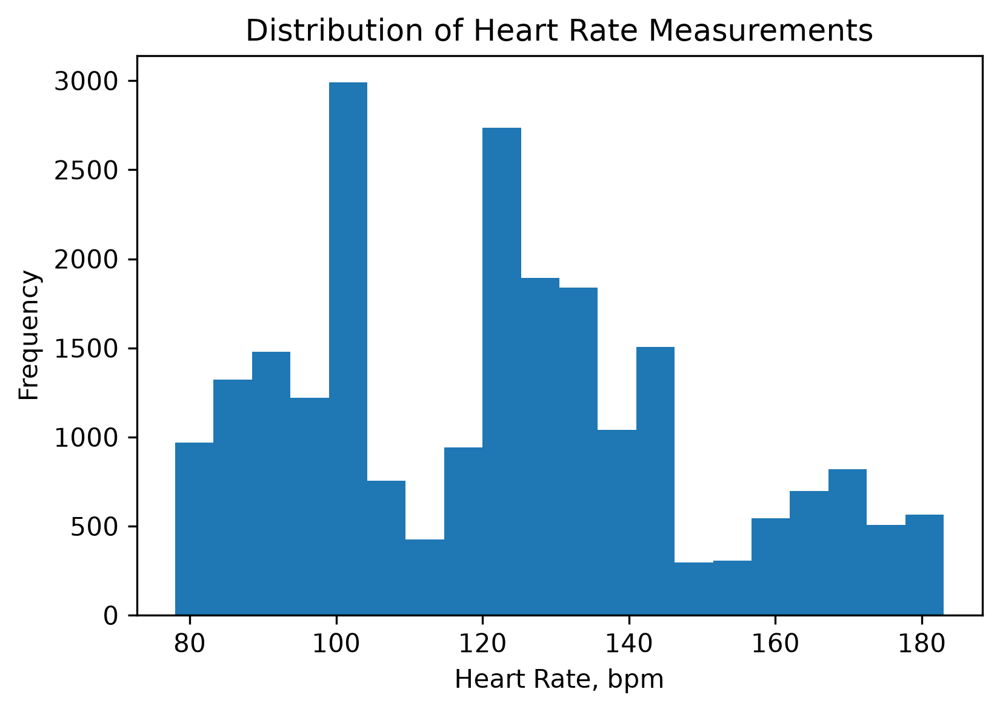
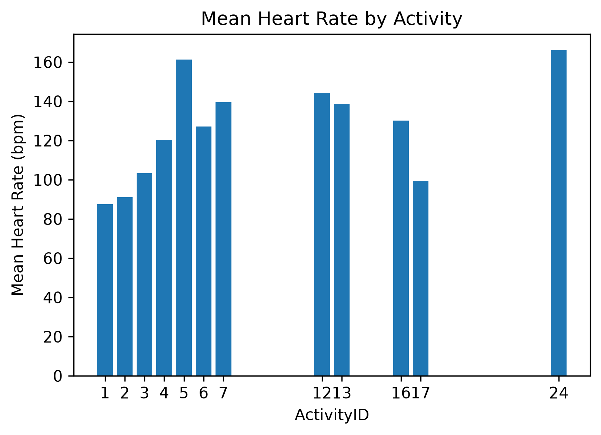
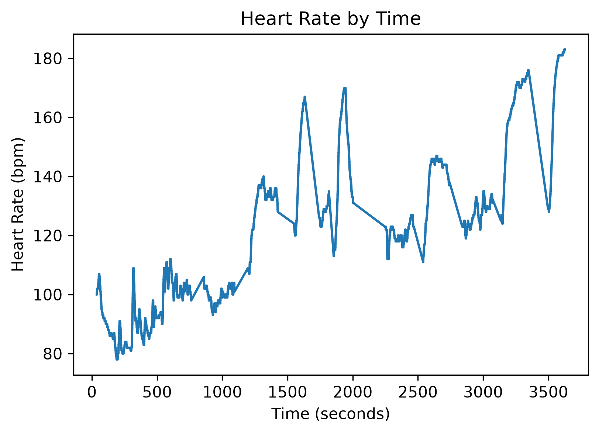
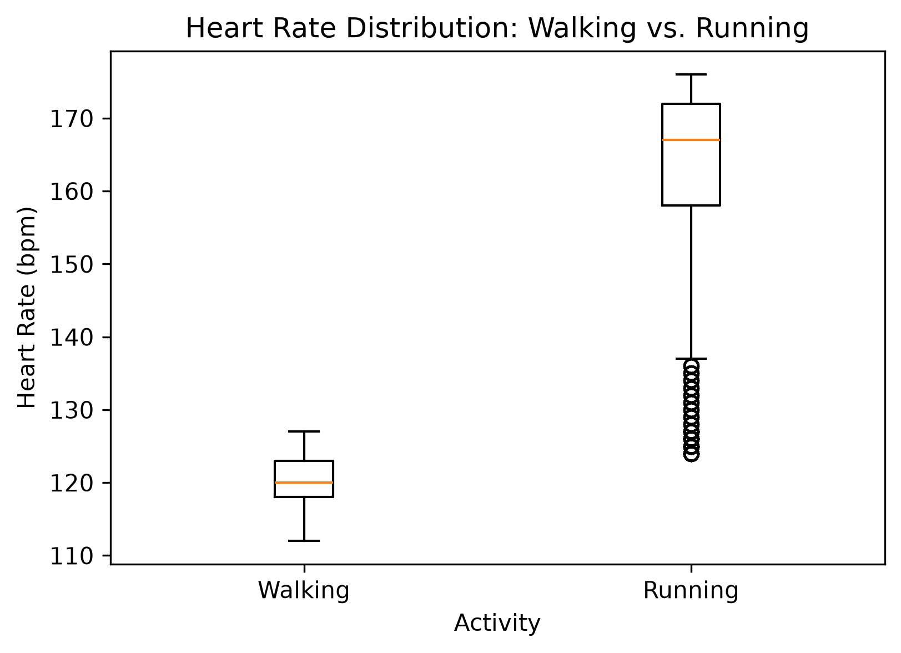

# PAMAP2 Physical Activity Data Analyzer

## Key Highlights

This project analyzes physiological measurements from the PAMAP2 Physical Activity Monitoring dataset using Python, pandas, and matplotlib.

**Key results:**
- **376,417 original observations** processed and cleaned into **22,846 valid observations**.
- **122.18 bpm** average heart rate across the cleaned dataset.
- **120.44 bpm** average heart rate during walking.
- **161.34 bpm** average heart rate during running.
- **40.90 bpm** higher average heart rate during running compared with walking.
- **Four visualizations** generated to examine heart-rate distributions, activity differences, and changes over time.

## 1. Project Overview
The PAMAP2 Physical Activity Data Analyzer is a Python-based exploratory data analysis project focused on examining heart-rate measurements across different physical activities.

The project demonstrates practical applications of data cleaning, descriptive statistics, data visualization, and file management using Python, pandas, and matplotlib.

The primary objectives are to:
- Import and process real-world physiological data.
- Clean the dataset by removing invalid and missing observations.
- Calculate descriptive statistics for heart-rate measurements.
- Explore differences in heart rate across physical activities.
- Generate and export four visualizations.
- Export the cleaned dataset for further analysis.

## 2. Dataset

**Source:** Reiss, A. (2012). *PAMAP2 Physical Activity Monitoring* [Dataset]. UCI Machine Learning Repository. https://doi.org/10.24432/C5NW2H

**Dataset:** [PAMAP2 Physical Activity Monitoring — UCI Machine Learning Repository](https://archive.ics.uci.edu/dataset/231/pamap2+physical+activity+monitoring)

**Participant:** Subject 101 (`subject101.dat`)

The PAMAP2 dataset contains physiological and motion-sensor measurements collected during different physical activities. This project focuses specifically on heart-rate measurements from one participant.

### Variables Analyzed

| Variable | Description |
|---|---|
| `timestamp` | Time of measurement in seconds |
| `activityID` | Numerical identifier for the physical activity |
| `heart_rate` | Heart rate in beats per minute (bpm) |

### Dataset Summary

| Measurement | Count |
|---|---:|
| Original observations | 376,417 |
| Cleaned observations | 22,846 |
| Variables retained | 3 |

Observations containing missing heart-rate measurements or an activity ID of 0 were excluded. Activity ID 0 represents transient activities that are not included in the primary analysis.

## 3. Technologies Used

- **Python:** Data processing and statistical analysis
- **pandas:** Data manipulation, filtering, grouping, and descriptive statistics
- **matplotlib:** Data visualization and figure exporting
- **pathlib:** File and directory management

## 4. Methodology

### 4.1 Data Loading

The dataset is imported using pandas `.read_csv()`.

Because the original `.dat` file contains whitespace-separated values without column headers, the parameters `sep=r"\s+"` and `header=None` are specified.

The first three columns are renamed using `.rename()` to identify timestamp, activity ID, and heart rate.

### 4.2 Data Cleaning

The following cleaning procedures are applied:

1. Select the three relevant variables: `timestamp`, `activityID`, and `heart_rate`.
2. Remove observations containing missing heart-rate measurements using `.dropna()`.
3. Exclude observations with `activityID == 0`, representing transient activities.
4. Retain the cleaned dataset for statistical analysis and visualization.

After cleaning, the dataset contains **22,846 observations**, compared with the original 376,417 observations.

### 4.3 Descriptive Statistics

The following statistics are calculated:

- Mean heart rate
- Maximum heart rate
- Minimum heart rate
- Standard deviation of heart rate
- Mean heart rate by activity
- Number of observations by activity

The `.groupby()` method is used to calculate mean heart rate for each activity ID, while `.value_counts()` determines the number of observations associated with each activity.

### 4.4 Data Visualization

Four visualizations are generated using matplotlib:

**1. Heart Rate Distribution — Histogram**

Displays the frequency distribution of heart-rate measurements across all retained observations.

**2. Mean Heart Rate by Activity — Bar Chart**

Compares average heart-rate measurements across different physical activity IDs.

**3. Heart Rate Over Time — Time-Series Plot**

Displays changes in heart rate throughout the recorded activity sessions.

**4. Walking vs. Running — Box Plot**

Compares the distributions of heart-rate measurements during walking (`activityID == 4`) and running (`activityID == 5`).

### 4.5 Data Export

The cleaned dataset is exported as a CSV file using pandas `.to_csv()` with `index=False`.

All four visualizations are saved as PNG files using `plt.savefig()` at 300 DPI.

Generated files are stored in the `outputs/` directory.

## 5. Results

### 5.1 Descriptive Statistics

| Measurement | Result |
|---|---:|
| Cleaned observations | 22,846 |
| Mean heart rate | 122.18 bpm |
| Minimum heart rate | 78 bpm |
| Maximum heart rate | 183 bpm |
| Standard deviation | 26.60 bpm |
| Mean walking heart rate | 120.44 bpm |
| Mean running heart rate | 161.34 bpm |

### 5.2 Key Findings

**Heart Rate and Physical Activity**

The mean heart rate during running was 161.34 bpm, approximately 40.90 bpm higher than the mean walking heart rate of 120.44 bpm. This difference is consistent with the increased cardiovascular demands associated with running.

**Heart Rate Variability**

The overall standard deviation of 26.60 bpm indicates substantial variation in heart-rate measurements across the recorded activities. Differences in activity type and exercise intensity may contribute to this variability.

**Limitations of the Analysis**

The analysis uses data from only one participant. Individual physiological characteristics, fitness levels, and exercise responses may differ across populations. Therefore, these findings should not be generalized to a broader population without additional data.

## 6. Visualizations

### 6.1 Heart Rate Distribution



The histogram displays the distribution of heart-rate measurements across all retained observations.

### 6.2 Mean Heart Rate by Activity



The bar chart compares average heart rates across the recorded physical activity IDs.

### 6.3 Heart Rate Over Time



The time-series visualization illustrates changes in heart rate throughout the recorded activities.

### 6.4 Walking vs. Running



The box plot compares heart-rate distributions during walking and running, including their medians, quartiles, and potential outliers.

## 7. Project Structure

```text
pamap2-physical-activity-analysis/
├── main/
│   └── pamap2_analysis.py
├── data/
│   └── subject101.dat
├── outputs/
│   ├── cleaned_fitness_data.csv
│   ├── Histogram_dist_hr.png
│   ├── Mean_hr_act.png
│   ├── hr_by_t.png
│   └── hr_walking_vs_running.png
├── README.md
├── requirements.txt
└── .gitignore
```

**Note:** The raw dataset and generated CSV are excluded from the GitHub repository using `.gitignore`. The raw dataset must be downloaded separately before running the program.


## 8. Installation and Usage

### Step 1: Clone the Repository

```bash
git clone https://github.com/etrykk/pamap2-physical-activity-analysis.git
cd pamap2-physical-activity-analysis
```

### Step 2: Install Dependencies

Ensure Python 3 is installed, then install the required libraries:

```bash
pip install -r requirements.txt
```

### Step 3: Download the Dataset

Download the PAMAP2 Physical Activity Monitoring dataset from the [UCI Machine Learning Repository](https://archive.ics.uci.edu/dataset/231/pamap2+physical+activity+monitoring).

Extract `subject101.dat` from the `Protocol` folder and place it inside a `data/` folder in the project's root directory.

### Step 4: Run the Analysis

From the project's root directory, run:

```bash
python main/pamap2_analysis.py
```

### Step 5: View the Results

The script automatically creates an `outputs/` directory and saves:

- Four PNG visualizations of heart-rate data.
- `cleaned_fitness_data.csv` containing the cleaned observations.

The program also displays descriptive statistics in the console, including mean, minimum, maximum, and standard deviation of heart rate, along with activity-level summaries.

## 9. Limitations and Future Improvements

### Limitations

- The analysis uses data from a single participant.
- Observations with missing heart-rate measurements are excluded.
- Removing missing measurements may introduce selection bias.
- The analysis focuses on descriptive statistics rather than causal relationships.
- Results may not generalize to other populations.

### Potential Improvements

- Expand the analysis to include additional participants.
- Compare physiological responses across more physical activities.
- Explore correlations between heart rate and motion-sensor measurements.
- Implement statistical hypothesis testing.
- Develop machine learning models for activity classification.
- Create interactive dashboards for exploring physiological data.

## 10. Data Source and Acknowledgment

This project uses the PAMAP2 Physical Activity Monitoring dataset from the UCI Machine Learning Repository.

**Citation:**

Reiss, A. (2012). *PAMAP2 Physical Activity Monitoring* [Dataset]. UCI Machine Learning Repository. https://doi.org/10.24432/C5NW2H

The dataset is used for educational and exploratory data analysis purposes. The data processing, statistical analysis, and visualizations were developed independently using Python.

## 11. Author

**etrykk**

Python Data Analysis Portfolio Project — November 2026

**GitHub:** [github.com/etrykk](https://github.com/etrykk)
